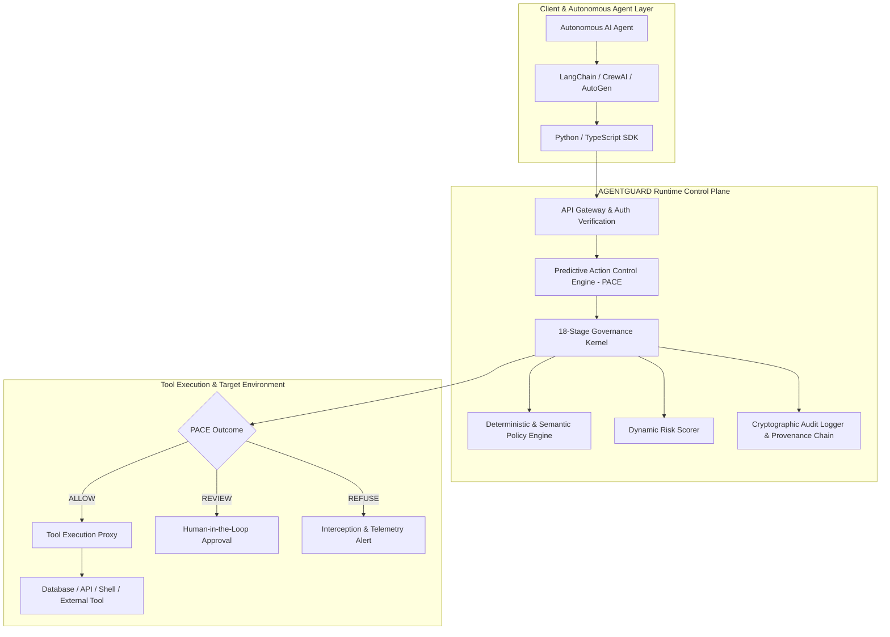

# AGENTGUARD Architecture Documentation

Welcome to the AGENTGUARD Architecture Documentation. This directory provides in-depth architectural specifications, runtime state machines, identity models, and governance kernel designs.

---

## 1. Primary Architecture Document

- [AGENTGUARD Master System Flow & Operational Specification](AGENTGUARD_MASTER_SYSTEM_FLOW.md): The authoritative master target architecture covering the 18-stage governance kernel, actor hierarchy, PACE evaluation flow, cryptographic provenance, multi-tenancy isolation, and operational lifecycle.

---

## 2. Architectural Pillars

AGENTGUARD is built on four core architectural pillars:

1. **Non-Bypassable Runtime Mediation:** All tool invocations and autonomous actions initiated by AI agents must pass through the PACE control plane before executing on external infrastructure.
2. **Deterministic & Semantic Policy Precedence:** Risk evaluations combine deterministic rule matching (regex, parameter ranges, schema checks) with semantic context evaluation (intent detection, anomaly scoring, prompt injection heuristics).
3. **Cryptographic Proof & Immutability:** Agent actions, approvals, and overrides are recorded in an append-only audit log bound by SHA-256 provenance hash-chains.
4. **Tenant Isolation with Platform Governance:** Multi-tenant organization boundaries isolate policies, datasets, and credentials while enabling platform operators (`SUPER_ADMIN`) to monitor platform health and manage subscription licensing.

---

## 3. High-Level System Architecture Diagram

---

## 4. Key Architectural Subsystems

1. **Identity & Authentication:** JWT bearer tokens, API keys (`ag_live_*`), and machine agent identities with cryptographic passports.
2. **Predictive Action Control Engine (PACE):** Real-time evaluation pipeline returning `ALLOW`, `REVIEW`, or `REFUSE` decisions.
3. **IAM & Role Hierarchy:** Five canonical organizational roles (`ADMIN`, `MANAGER`, `SECURITY_OFFICER`, `AUDITOR`, `AGENT`) plus platform operator (`SUPER_ADMIN`).
4. **Data Persistence & State:** PostgreSQL / Supabase storage with Redis caching and Celery background workers for asynchronous tasks and scheduled compliance reporting.
